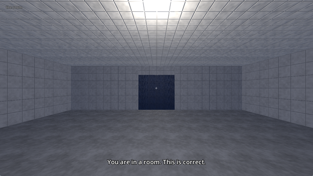

# THE DOOR

**a first-person walking simulator about a hallway. and one door.**

built with godot 4.7.2. no endings yet. you walk down a corridor, a narrator talks to you, and there is a door. that is the whole game so far and it is somehow enough.

<p align="center">
  
</p>

## what's in here

- a repeating 3d corridor with real movement, head bob, footsteps and collision
- a persistent narrator with subtitles, room labels and scene fades
- a door that swings open, closes behind you, and makes sounds
- a menu with animated typewriter title, fade-in buttons and a 3d background
- settings, pause menu, persistence, vignette and photo-mode-ish screenshots
- **DOORSOFT**: an original proprietary binary asset format family with a headless CLI packer and runtime loaders

no endings. on purpose. ask later.

## run it

grab the portable godot 4.7.2 console build (no winget, no installer) and point it at the project:

```powershell
$Godot = "C:\path\to\Godot_v4.7.2-stable_win64_console.exe"

& $Godot --path .              # starts at menu.tscn
& $Godot --path . main.tscn    # skip the menu, go straight to the hallway
```

headless smoke test:

```powershell
& $Godot --headless --path . main.tscn --quit-after 300
& $Godot --headless --path . menu.tscn --quit-after 300
```

## controls

| input | action |
|---|---|
| `W A S D` | walk |
| mouse | look around |
| `E` | interact with the door |
| `Esc` | pause / release mouse |
| click | recapture mouse |

## assets

textures and audio are generated procedurally at runtime, but packed DOORSOFT files in `assets/` take priority when present. drop a `.drtx` or `.drau` in the right folder and the game uses it. corrupt files fall back to procedural generation instead of crashing.

full format docs + CLI commands: [DOORSOFT.md](DOORSOFT.md)

**companion app:** [door-inspector](https://github.com/the-silly-team/door-inspector) opens every `.dr*` file natively — previews textures, plays audio, follows references, dumps hex. standalone python, zero godot.

## credits

- **lux** — design, ideas, vibes
- **opencode** — most of the actual code (unpaid labor, still showing up)
- **the silly team** — the corporate umbrella

built with :3 and concerning amounts of coffee.
